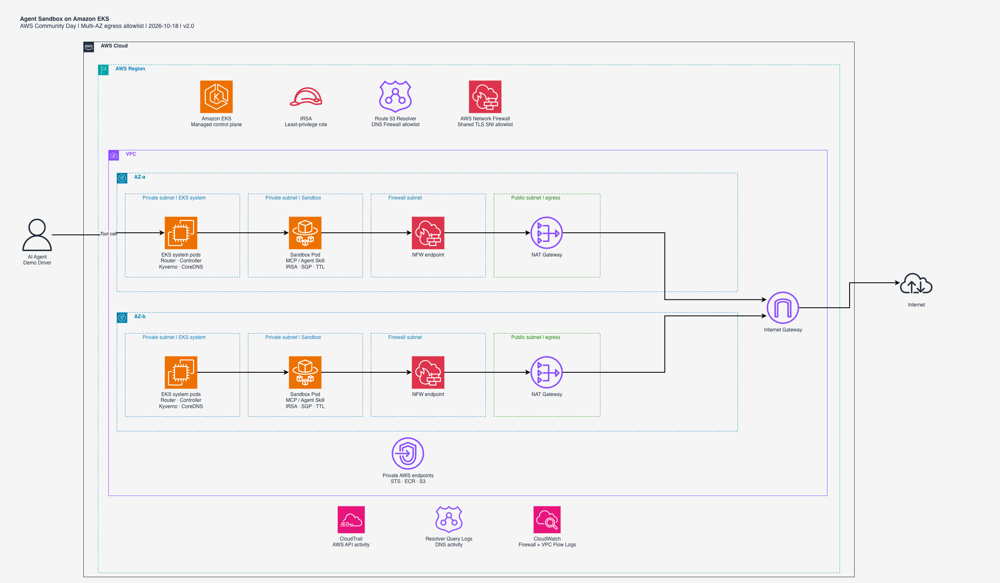

# 아키텍처

## 계층별 선택

Agent Sandbox가 주는 것은 `Sandbox` / `SandboxTemplate` / `SandboxClaim` / `SandboxWarmPool` 같은 **수명주기 API**입니다. 격리 런타임은 사용자가 따로 골라야 합니다([위협 모델](https://github.com/kubernetes-sigs/agent-sandbox/blob/main/docs/security/threat_model.md)). 이 레포는 EKS에서 그 빈칸을 다음 계층으로 채웁니다.

| 계층 | 이 레포의 선택 | 대안 (비교만 함) |
|---|---|---|
| 수명주기 | agent-sandbox `SandboxClaim` + `shutdownTime` | Job + `ttlSecondsAfterFinished` |
| 런타임 격리 | **EKS Fargate** (Pod마다 전용 microVM·커널) | EC2 + gVisor, EC2 + Kata |
| AWS 권한 | **IRSA** (최소 권한 role) | EKS Pod Identity (Fargate 미지원) |
| 네트워크 | `SecurityGroupPolicy` + AWS Network Firewall 도메인 allowlist + NAT | NetworkPolicy (Fargate 미지원) |
| 관측 | CloudTrail, Fargate stdout/stderr, Route 53 Resolver Query Logs, Network Firewall 로그, VPC Flow Logs | eBPF 기반 syscall 관측 (Fargate·gVisor에서 전제가 약함) |

## 데모 시나리오

> 도구에 실행 환경을 할당하고 예시 텍스트를 전달한다
> → 같은 환경에서 고정된 AWS·DNS·HTTPS 대상의 접근 결과를 점검한다
> → Claim을 반환하고 Sandbox와 해당 Pod의 삭제를 확인한다.

`summarize`는 공백을 정리하고 앞 240자를 반환하는 부작용 없는 예시입니다. PDF 파싱이나 AI 요약은 구현하지 않습니다. 별도의 `check_sandbox_boundary` 호출이 다음을 시도하며 PDF 본문을 외부로 보내지 않습니다.

1. `sts:GetCallerIdentity`: 권한이 없어도 성공하는 호출이며 CloudTrail에 남습니다.
2. `s3:ListBuckets`: 역할에 S3 허용 정책이 없고 S3 VPC Endpoint 정책도 이미지 레이어 읽기로 제한되어 있습니다. AccessDenied가 예상되지만 이 응답만으로 역할 정책 단독 효과나 CloudTrail 기록 여부를 단정하지 않습니다.
3. `https://example.org` 호출: DNS는 허용하지만 TLS SNI가 HTTPS allowlist 밖이므로 Network Firewall이 거부합니다.
4. `https://example.com` 호출: 허용된 TLS SNI로 NAT를 통해 연결됩니다.
5. `evil.example.com` DNS 조회: Resolver Query Logs에 남고, Route 53 DNS Firewall이 거부합니다. 이 도메인으로 HTTPS를 시도하면 DNS 차단이 먼저 일어나므로 Network Firewall 동작은 `example.org`로 분리해 관찰합니다.

데모 결과는 `PASS/SAFE` 대신 **관측한 사실**로 출력합니다.

```
Observed:
- sts:GetCallerIdentity 호출
- s3:ListBuckets AccessDenied
- evil.example.com 이름 해석 실패 (원인은 DNS 로그와 대조)
- allowlist 밖 HTTPS 연결 실패 (원인은 방화벽 로그와 대조)
- 허용된 도메인 HTTPS 연결 성공
- Claim 반환 후 Claim·Sandbox·해당 Pod 삭제 확인

Not observed != safe
```

라이브 시연·재촬영에서는 Warm Pool을 미리 준비하고 약 2분 동안 네 단계를 보여줍니다. v20 발표는 이 실제 실행 기록을 편집한 **60초 영상(20장)**을 사용하며, 23장에서 같은 Pod의 방화벽 로그를 대조합니다. TTL은 Claim 생성 시점부터 기본 5분이며 반환 누락 대비용입니다. [데모 실행과 발표 멘트](../demo/README.md)에 영상, 실제 로그 대조 방법과 실패 시 전환 멘트가 있습니다.

**의도적으로 다루지 않는 것:** 미끼 파일 읽기 검출은 제외합니다. `readOnlyRootFilesystem`은 쓰기만 막고 읽기 증거는 남기지 않습니다. 읽기를 검출하려면 fanotify/audit, 파일 접근 중개 API, syscall 관측 같은 별도 계층이 필요하고, 이는 별도 연구 주제입니다.

## 구성도

운영 설계 기준은 **최소 3개 AZ**입니다. Terraform의 AZ 수 기본값은 3이며, 발표 데모만 `environment = "demo"`, `availability_zone_count = 2`로 축소합니다. 아래 2개 AZ 그림은 데모 배치를 설명합니다. 운영에서는 같은 서브넷·방화벽·NAT 구성을 세 번째 AZ에도 배치합니다. 한 AZ 장애 후 나머지 두 AZ에서 처리할 수 있도록 Pod 분산과 여유 용량, 중단된 작업의 복구를 별도로 검증해야 합니다. AZ 수만으로 애플리케이션의 고가용성을 보장하지 않습니다.

제안 아키텍처 (구현 전)



편집 가능한 [draw.io 원본](diagrams/agent-sandbox-eks.drawio)과 [다이어그램 안내](diagrams/agent-sandbox-eks.md)입니다. 각 AZ에 system private, Sandbox private, 전용 firewall, public egress 서브넷을 둡니다. AWS Network Firewall endpoint와 NAT를 AZ별로 배치하고, 모든 endpoint에서 동일한 HTTPS allowlist를 적용합니다. Kyverno는 admission guardrail을 적용하고, `SecurityGroupPolicy`는 전용 SG를 Fargate Pod에 붙입니다. 내부 서비스의 SG도 Sandbox 접근을 허용하지 않도록 구성합니다. Kyverno가 생성한 NetworkPolicy는 Fargate 트래픽을 차단하지 않습니다.

설계 원칙:

- **허용 목록으로 egress를 제한합니다.** Sandbox subnet의 외부 경로는 AZ별 AWS Network Firewall endpoint로 향하고, TLS SNI allowlist를 통과한 HTTPS만 NAT와 Internet Gateway를 통해 나갑니다. Route 53 DNS Firewall은 허용된 도메인의 질의만 통과시킵니다. 왕복 트래픽이 같은 firewall endpoint를 통과하도록 route table을 구성합니다. VPC 내부 `local` 경로는 egress firewall을 거치지 않으므로, 내부 서비스의 Security Group에서 sandbox 접근을 허용하지 않는지 별도로 검증합니다.
- **Fargate 하나만 끝까지 구현합니다.** gVisor와 Kata는 비교표와 후속 실험으로 남깁니다.
- **Warm Pool은 선택 사항입니다.** Fargate에서도 쓸 수 있지만, 대기 중인 Pod도 microVM 비용이 계속 나갑니다. 콜드 스타트 시간을 측정한 뒤 켤지 정합니다.

### Fargate의 트레이드오프

| 항목 | 영향 |
|---|---|
| Pod마다 전용 커널·compute boundary | 첫 구현의 격리 경계로 가장 단순함 |
| IMDS 접근 불가 | 노드 자격증명 탈취 경로가 없음 |
| DaemonSet 불가 | 노드 기반 관측 에이전트를 쓸 수 없고 sidecar나 AWS 측 로그에 의존 |
| RuntimeClass 선택 불가 | gVisor/Kata와 겹쳐 쓸 수 없음 |
| privileged, hostNetwork 불가 | 샌드박스 입장에서는 장점 |
| NetworkPolicy 미적용 | egress 통제를 서브넷 라우팅, SecurityGroupPolicy, AWS Network Firewall로 해결해야 함 |
| Pod Identity 미지원 | IRSA 사용 |
| 유휴 Warm Pool Pod도 과금 | 콜드 스타트 지연과 유휴 비용 중 하나를 골라야 함 |

### 런타임 비교 (발표용, 구현 범위 밖)

| | Fargate | EC2 + gVisor | EC2 + Kata |
|---|---|---|---|
| 격리 경계 | microVM (AWS 관리) | 사용자 공간 커널 | 경량 VM |
| 노드 관리 | 없음 | 노드 이미지·containerd 설정 | 노드 이미지·containerd 설정, KVM 필요 |
| 하드웨어 요건 | 없음 | 없음 | metal, 또는 nested virtualization 지원 인스턴스(C/M/R 7i·8i 등) |
| 노드 레벨 관측 (eBPF) | 불가 | 샌드박스 내부 syscall 관측 전제가 약함 | 게스트 커널 안은 보이지 않음 |
| 기동 속도 | 느림 (수십 초) | 빠름 | 중간 |

## 참고

- [kubernetes-sigs/agent-sandbox](https://github.com/kubernetes-sigs/agent-sandbox)
- [Agent Sandbox 위협 모델](https://github.com/kubernetes-sigs/agent-sandbox/blob/main/docs/security/threat_model.md)
- [EKS Fargate considerations](https://docs.aws.amazon.com/eks/latest/userguide/fargate.html)
- [Security Groups for Pods with Fargate](https://docs.aws.amazon.com/eks/latest/best-practices/sgpp.html)
- [VPC CNI network policy considerations](https://docs.aws.amazon.com/eks/latest/userguide/cni-network-policy.html)
- [AWS Network Firewall domain list rules](https://docs.aws.amazon.com/network-firewall/latest/developerguide/stateful-rule-groups-domain-names.html)
- [AWS Network Firewall routing architectures](https://docs.aws.amazon.com/network-firewall/latest/developerguide/architectures.html)
- [Route 53 Resolver DNS Firewall](https://docs.aws.amazon.com/Route53/latest/DeveloperGuide/resolver-dns-firewall-overview.html)
- [EKS Pod Identity restrictions](https://docs.aws.amazon.com/eks/latest/userguide/pod-identities.html)
- [EC2 nested virtualization](https://docs.aws.amazon.com/AWSEC2/latest/UserGuide/amazon-ec2-nested-virtualization.html)
